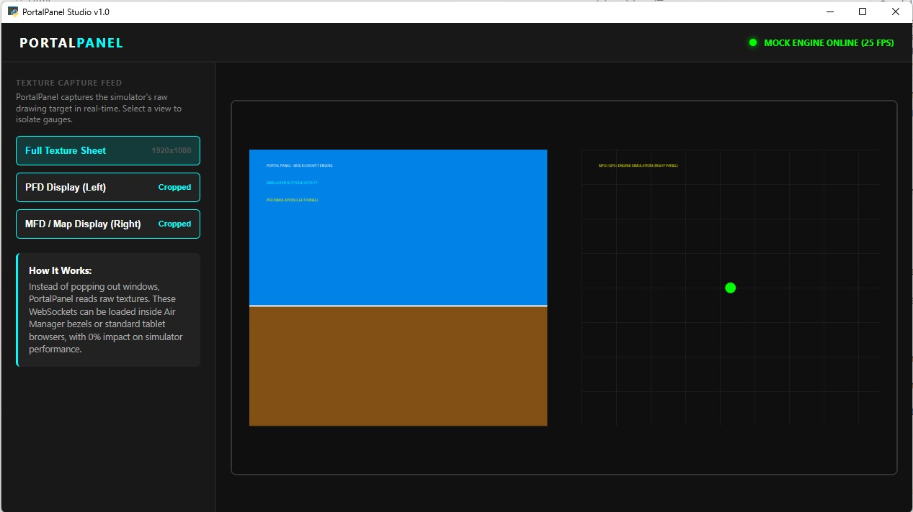

# PortalPanel



**Live instrument panel display for Microsoft Flight Simulator 2024 (and 2020), built for VR passthrough setups.**

## Overview

PortalPanel reads live flight data from MSFS via SimConnect and renders custom PFD (Primary Flight Display) and MFD (Multi-Function Display) instruments in a web view. This lets you see and interact with instrument panels on external monitors — even while flying in VR with passthrough enabled.

## Why PortalPanel?

MSFS's built-in "Pop Out" feature stops working when VR is enabled. PortalPanel solves this by reading instrument data directly through SimConnect (MSFS's official API) and rendering it in a web view, which works perfectly alongside VR passthrough (OpenKneeboard, etc.).

## Features

- **Live PFD** — attitude indicator, airspeed tape, altitude tape, heading tape, VSI, NAV frequencies, baro setting
- **Live MFD** — engine RPM, temperatures, fuel quantities, electrical, position data
- **Multiple views** — combined PFD+MFD, standalone PFD, standalone MFD
- **VR compatible** — works with VR passthrough
- **Aircraft agnostic** — works with any aircraft that exposes standard SimConnect variables
- **Optional hardware panel** — ESP32-S3 control surface with rotary encoders, an OLED readout, and momentary buttons (see [Hardware & Firmware](#hardware--firmware))

## Requirements

- Microsoft Flight Simulator 2024 or 2020, running with **Developer Mode** enabled
- The Windows app is self-contained — no Python install needed to *run* it.
- To *build* from source: Python 3.8+ and the MSFS SimConnect SDK (installed with the game).

## Installing the Windows App

Two options — both from the [Releases](../../releases) page:

**Option 1: Installer (recommended)** — download `PortalPanel-Setup-v1.1.exe` and double-click. Installs per-user (no admin needed), creates Desktop + Start Menu shortcuts, and adds an uninstaller. Requires WebView2 (preinstalled on Windows 10 21H2+ / Windows 11).

**Option 2: Portable zip** — download `PortalPanel-v1.1-win64.zip`, extract to a folder (for example `C:\PortalPanel`), then run:

```
PortalPanelLauncher.exe
```

The launcher starts the backend server, opens the instrument window, and shows a monitor picker so you can choose which screen the panel appears on. Your settings are saved automatically in `%LOCALAPPDATA%\PortalPanel\`.

## Usage

1. Launch MSFS and load into your aircraft's cockpit.
2. Run `PortalPanelLauncher.exe` (or, from source: `python manager\portalpanel.py`).
3. Choose your display:
   - **Combined** — PFD + MFD side by side
   - **PFD only**
   - **MFD only**

## Building from Source (PyInstaller)

```bat
python -m venv venv
venv\Scripts\activate
pip install -r requirements.txt
pip install pyinstaller
set USERPROFILE=C:\Users\%USERNAME%      & rem Windows gotcha: PyInstaller needs this set
pyinstaller --noconfirm PortalPanel.spec
```

Output lands in `dist\PortalPanel\` with two executables (`PortalPanelLauncher.exe`, `PortalPanelServer.exe`) and the `_internal\` dependency folder. Copy the `web\`, `data\`, and `profiles\` folders next to the exes before running.

> **Build notes:** each executable is built from its own PyInstaller `Analysis` (a shared one causes the server's `__main__` block to be skipped), and `engineio.async_drivers.threading` must be listed as a hidden import — both are already handled in `PortalPanel.spec`.

## Hardware & Firmware

An optional 3D-printed control panel lets you drive the instruments with physical rotary encoders, an OLED readout, and momentary buttons.

- **Wiring, pinout, BOM, and diagram:** [`firmware/WIRING.md`](firmware/WIRING.md)
- **ESP32-S3 firmware** (Arduino `.ino` sketches): `firmware/` — replace the `YOUR_WIFI_*` placeholders before uploading.
- **Printable housing** (STL + FreeCAD source): `hardware/`

## Project Structure

```
PortalPanel/
├── manager/
│   ├── portalpanel.py           # Launcher: starts server, opens webview, monitor picker
│   ├── portalpanel_server.py    # Flask + SimConnect backend server
│   └── instrument_reader.py     # Instrument variable reader
├── web/
│   ├── index.html               # Combined PFD + MFD view
│   ├── pfd.html                 # Standalone PFD
│   └── mfd.html                 # Standalone MFD
├── data/
│   └── airports.csv             # Airport database for the map / NRST
├── profiles/
│   └── Cessna_172_Skyhawk.json  # Example aircraft profile
├── firmware/                    # ESP32-S3 Arduino sketches + WIRING.md
├── hardware/                    # 3D-printable housing (STL, 3MF, FreeCAD)
├── docs/                        # Screenshots and design notes
├── PortalPanel.spec             # PyInstaller build spec
├── requirements.txt
└── README.md
```

## Tech Stack

- **Backend:** Python, Flask, flask-socketio, SimConnect
- **Frontend:** HTML5 Canvas + JavaScript (WebSocket push)
- **Hardware:** ESP32-S3, rotary encoders, OLED (I2C), momentary buttons
- **Data source:** MSFS SimConnect API

## License

GNU General Public License v3.0 (GPL-3.0) — free to use, modify, and share. If you distribute a modified version, you must also release it under GPL-3.0. See the [LICENSE](LICENSE) file for full terms.

## Author

Ronen — retired teacher, flight-sim enthusiast, 3D-printing and technology lover.
